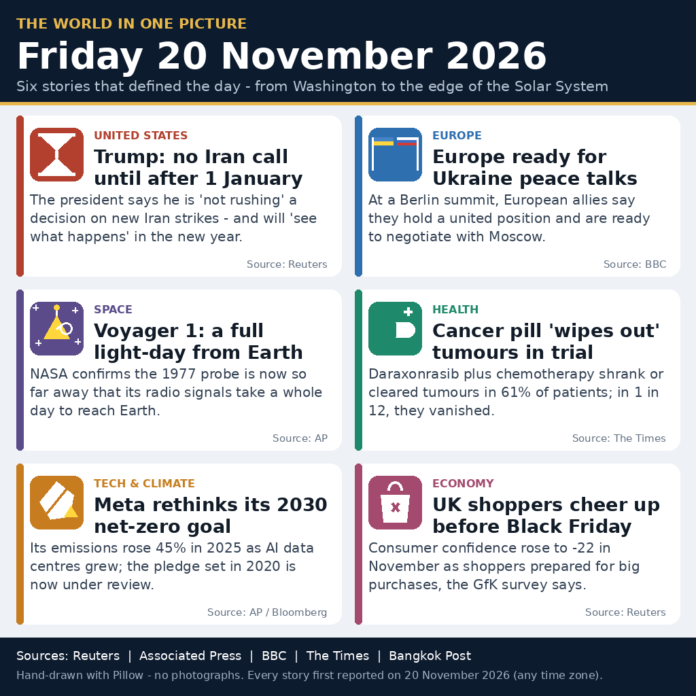

# Friday 20 November 2026 — the world in one image

[](https://make.fun/bounty/news-image-20261120)
[](https://make.fun/bounty/news-image-20261120)
[](https://make.fun/bounty/news-image-20261120)

An entry for the [make.fun bounty "Sum up 20 November's world news in one image"](https://make.fun/bounty/news-image-20261120): a hand-drawn 1024×1024 infographic that sums up Friday 20 November 2026 in six stories, from Washington to the edge of the Solar System.



## The six stories

1. **Trump: no Iran call until after 1 January** — The US president says he is "not rushing" a decision on new strikes against Iran and will "see what happens" after the new year. ([Reuters via Arab News](https://www.arabnews.com/middle-east/trump-says-us-will-see-what-happens-in-conflict-with-iran-after-january-1-3012926))
2. **Europe ready for Ukraine talks with Russia** — At a Berlin summit of the Coalition of the Willing, European allies say they hold a united negotiating position and are ready to negotiate with Moscow to end the war. ([BBC](https://bbcbreakingnews.pages.dev/news/articles/ckzd9nln5e6go))
3. **Voyager 1: a full light-day from Earth** — NASA confirms the 1977 probe is now so far away that its radio signals take a whole day to reach Earth — the first human-made object to pass that mark. ([Associated Press](https://phys.org/news/2026-11-nasa-voyager-home-awe-day.html))
4. **Cancer pill "wipes out" tumours in trial** — Daraxonrasib plus chemotherapy shrank or cleared tumours in 60.7% of patients with metastatic pancreatic cancer; in 8.2% — about 1 in 12 — tumours vanished on scans. ([The Times](https://www.thetimes.com/uk/healthcare/article/pancreatic-cancer-drug-wipes-out-tumours-daraxonrasib-sxq0mpgxx))
5. **Meta rethinks its 2030 net-zero goal** — In its annual sustainability report Meta says it is "re-evaluating" the 2030 target; its net emissions rose 45% in 2025 as AI data centres grew. ([Associated Press via Bangkok Post](https://www.bangkokpost.com/world/3358180/meta-says-reevaluating-2030-net-zero-target-amid-ai-buildout))
6. **UK shoppers cheer up before Black Friday** — Consumer confidence rose 2 points to −22 in November as shoppers prepared for big purchases, the GfK survey says. ([Reuters](https://www.reuters.com/world/uk/uk-gfk-consumer-sentiment-edges-up-after-october-slump-2026-11-20/))

### A note on dates

20 November 2026 in any time zone is the contest's definition of the day's news. Every story above was first reported on 20 November in at least one time zone: the GfK survey was released at 00:01 GMT on 20 November; the Berlin summit statement, the Meta report and the Trump interviews were reported late on 19 November UTC and carried as 20 November headlines across Asia and the Pacific; the Voyager confirmation likewise reached Asian editions on 20 November. Nothing here is presented as having happened on 20 November when it happened earlier — the Voyager crossing itself, for example, was on 18 November; what is new on the 20th is NASA's confirmation reaching the world's front pages.

## How it works

- `draw_infographic.py` (build time only, Pillow + DejaVu fonts) draws `entry.png`: a 1024×1024 hand-drawn infographic — header naming the day, six story cards with geometric icons, headlines and one-line summaries, and a sources footer. No photos, no network, no downloaded assets.
- `main.py` (Python 3.13, standard library only) copies `entry.png` to `$MAKEFUN_OUTPUT_DIR/entry.png`. It writes the same bytes on every run.

## Verify locally

```sh
python3 draw_infographic.py            # regenerate entry.png
mkdir -p /tmp/out1 /tmp/out2
MAKEFUN_OUTPUT_DIR=/tmp/out1 python3 main.py
MAKEFUN_OUTPUT_DIR=/tmp/out2 python3 main.py
sha256sum entry.png /tmp/out1/entry.png /tmp/out2/entry.png   # all three identical
python3 -c "from PIL import Image; im = Image.open('entry.png'); print(im.size, im.format)"
```

## License

MIT — see [LICENSE](LICENSE).
